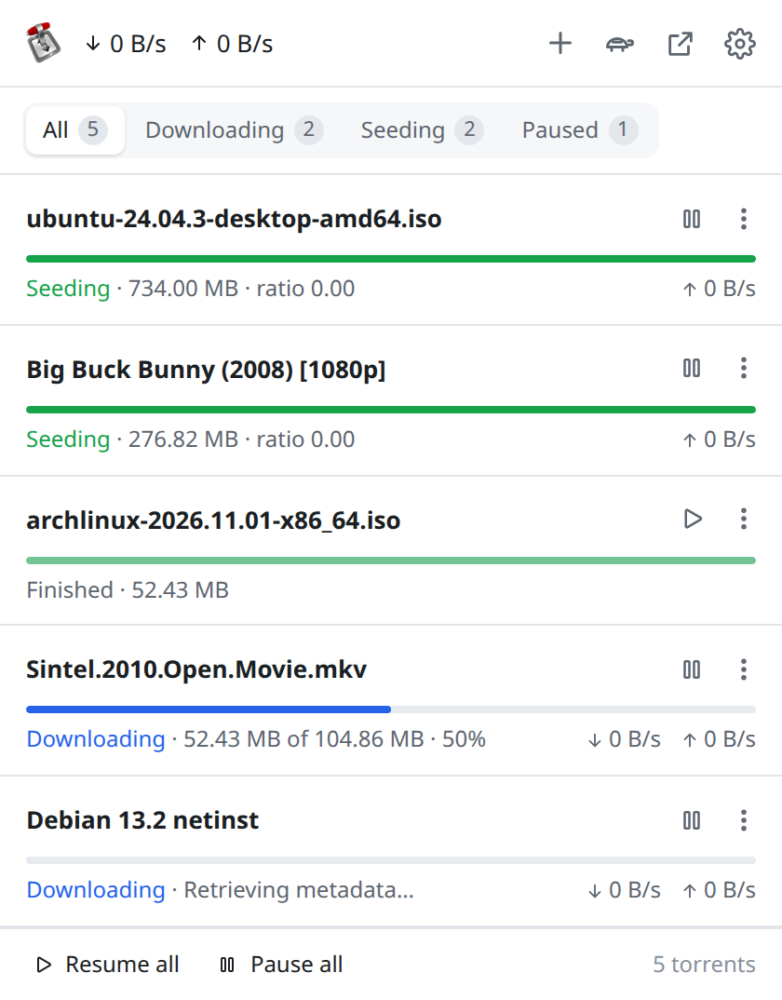
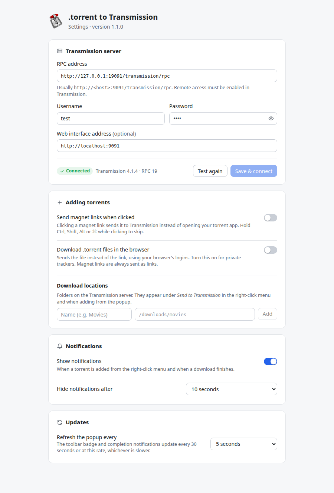
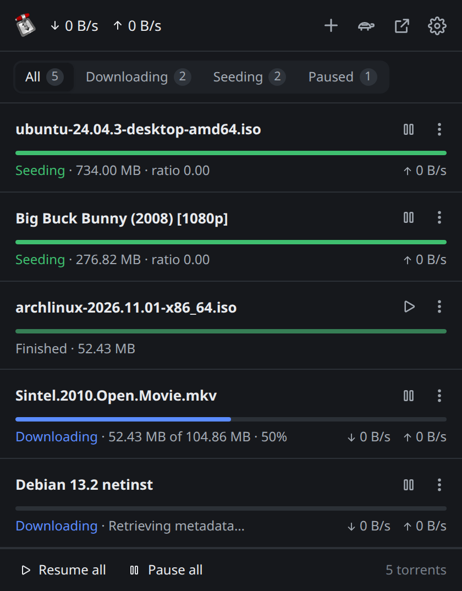
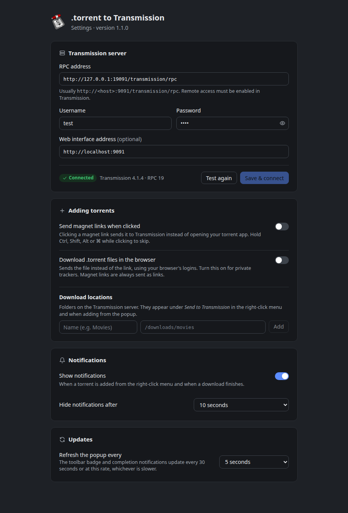

# .torrent to Transmission Chrome Extension

A Chrome extension that allows you to automatically add torrent files and magnet links to your Transmission BitTorrent client directly from your browser.

## Features

- **Send links from any page**: right-click a magnet or .torrent link and choose **Send to Transmission**, optionally into one of your download locations. You can also make plain clicks on magnet links go to Transmission.
- **Add from the popup**: paste a magnet link or .torrent URL.
- **Manage torrents**: pause, resume, verify, reorder the queue, or remove (with or without deleting files), filtered by state and searchable.
- **Live status**: speeds, progress, time left and ratio, plus a toolbar badge with downloading/seeding counts.
- **Notifications** when a torrent is added or finishes downloading.
- **Turtle mode**: toggle Transmission's alternative speed limits.
- **Light and dark themes** that follow your system.

| Popup | Settings |
|---|---|
|  |  |
|  |  |

## Installation

### From Source
1. Clone or download this repository
2. Install dependencies and build: `npm install && npm run build`
3. Open Chrome and navigate to `chrome://extensions/`
4. Enable "Developer mode" in the top right
5. Click "Load unpacked" and select the `.output/chrome-mv3` directory
6. The extension will appear in your browser toolbar

For Firefox, run `npm run build:firefox`, open `about:debugging#/runtime/this-firefox`, click "Load Temporary Add-on…" and select `.output/firefox-mv3/manifest.json`.

### Configuration
1. Click the extension icon, then the gear icon to open **Settings**.
2. Under **Transmission server**, enter the RPC address (default `http://localhost:9091/transmission/rpc`) and username/password if Transmission requires them, then click **Save & connect**. Your browser asks for permission to reach that server, and the page shows whether the connection works.
3. Everything else saves as you change it:
   - **Adding torrents**: send magnet links on click, download .torrent files in the browser (for private trackers), and **download locations** (named folders on the server)
   - **Notifications**: on/off and how long they stay
   - **Updates**: how often the popup refreshes

## Usage

### Adding torrents
- Right-click a magnet or .torrent link and choose **Send to Transmission**. If you've added download locations, pick one from the submenu.
- Or click **+** in the popup and paste a link.
- Or turn on **Send magnet links when clicked**, then just click magnet links. Hold Ctrl/Shift/Alt/⌘ to open them normally.

### Managing torrents
- Filter with the **All / Downloading / Seeding / Paused** tabs. A search box appears once you have more than a handful of torrents.
- Each row has pause/resume and a **⋯** menu with *Move up/down in queue*, *Verify local data* and *Remove…*. Removing asks whether to keep or delete the downloaded files.
- **Resume all** / **Pause all** at the bottom apply to every torrent.
- The turtle button toggles alternative speed limits, and the arrow button opens Transmission's web interface.

## Requirements

- Chrome 120 or newer, or Firefox 140 or newer
- Transmission BitTorrent client with RPC enabled
- Network access to your Transmission instance

### Transmission Setup
Make sure your Transmission daemon is configured to accept RPC connections:

1. **Enable RPC** in Transmission settings
2. **Set RPC port** (default: 9091)
3. **Configure authentication** if desired
4. **Allow RPC from your IP** (whitelist or disable whitelist for local access)

Example Transmission settings:
```json
{
    "rpc-enabled": true,
    "rpc-port": 9091,
    "rpc-whitelist-enabled": false,
    "rpc-authentication-required": false
}
```

## Permissions

This extension requires the following permissions:
- **contextMenus**: To add right-click menu options
- **notifications**: To show desktop notifications
- **storage**: To save your settings and torrent data
- **alarms**: To periodically update torrent status
- **scripting**: To enable the optional magnet link click handler

### Host access is opt-in

Website access is requested at runtime (`optional_host_permissions`), not at install:

1. **Your Transmission server only**: when you click **Save** in the options, the browser asks for access to the host in your RPC address (e.g. `192.168.1.100`). This is all the extension needs by default.
2. **All sites**: only requested if you enable **Send .torrent file** (to download the .torrent from the site you're browsing, with your login cookies) or **Send magnet links when clicked** (to detect clicks on magnet links).

If access is missing, the popup shows an **Allow access** button. Existing users updating from 1.1.x keep the access they already granted.

**Important Security Notes:**
- The extension ONLY communicates with URLs you explicitly configure in the options, plus .torrent links you choose to send
- No data is sent to any third-party servers
- You can review the source code to verify these claims

## Technical Details

- **Manifest Version**: 3 (modern Chrome extension format)
- **Background**: Service worker for efficient resource usage
- **Storage**: Uses Chrome's storage API instead of localStorage
- **Network**: Modern fetch API for HTTP requests
- **Language**: TypeScript, built with [WXT](https://wxt.dev)
- **UI**: [Svelte 5](https://svelte.dev) components with a shared theme (`src/assets/theme.css`), light/dark via `prefers-color-scheme`
- **Refresh**: Background refresh via `chrome.alarms` (minimum 30 seconds); the popup refreshes at the configured rate while open

## File Structure

```
├── wxt.config.ts                # WXT config (generates manifest.json)
├── public/img/                  # Extension icons
├── src/
│   ├── assets/theme.css         # Design tokens (light/dark) and base controls
│   ├── components/              # Shared Svelte components (Icon, Toggle)
│   ├── entrypoints/
│   │   ├── background.ts        # Service worker (context menu, badge, notifications)
│   │   ├── magnet.content.ts    # Optional magnet-click handler (registered at runtime)
│   │   ├── popup/               # Popup (App, TorrentRow, AddTorrent, ConnectionState)
│   │   └── options/             # Settings page (App)
│   └── utils/
│       ├── transmission.ts      # Transmission RPC communication and shared types
│       └── format.ts            # Size/speed/ETA formatting and torrent status text
└── tests/                       # Vitest unit tests and the e2e suite (tests/e2e)
```

## Development

| Command | Description |
|---|---|
| `npm run dev` / `dev:firefox` | Launch Chrome / Firefox with the extension loaded and hot reload |
| `npm run build` / `build:firefox` | Production build in `.output/chrome-mv3` / `.output/firefox-mv3` |
| `npm run zip` / `zip:firefox` | Build a zip for the Chrome Web Store / addons.mozilla.org (plus a sources zip) |
| `npm run compile` | Type-check with `tsc` and `svelte-check` |
| `npm test` | Run unit tests |
| `npm run test:e2e` | Run end-to-end tests in Chrome against a Transmission server (see `tests/e2e/run.mjs`) |

CI (`.github/workflows/ci.yml`) runs type-check, unit tests, both browser builds, a `web-ext` lint of the Firefox build and the end-to-end suite (against a Transmission service container) on every pull request. On merge to `master` it then runs the release (below).

### Releasing

Releases are automated with [semantic-release](https://semantic-release.gitbook.io/). Every merge to `master` that passes CI:

1. Determines the next version from [Conventional Commits](https://www.conventionalcommits.org/) since the last tag (`fix:` → patch, `feat:` → minor, `feat!:` / `BREAKING CHANGE:` → major; `ci:`, `docs:`, `chore:` etc. don't release)
2. Updates `package.json` and `CHANGELOG.md` and commits them as `chore(release): x.y.z`
3. Builds the Chrome and Firefox zips, creates a GitHub release with them, and comments on the released PRs/issues
4. Submits to each store whose secrets are configured (`scripts/submit-stores.sh`):
   - Chrome Web Store: `CHROME_EXTENSION_ID`, `CHROME_CLIENT_ID`, `CHROME_CLIENT_SECRET`, `CHROME_REFRESH_TOKEN`
   - Firefox Add-ons: `FIREFOX_EXTENSION_ID`, `FIREFOX_JWT_ISSUER`, `FIREFOX_JWT_SECRET`

PRs are squash-merged, so **PR titles must be Conventional Commits** (checked by the `PR title` workflow). Run `npx wxt submit init` to generate the store secrets, and the **Validate store credentials** workflow to check them.

### Testing
1. Run `npm test` and `npm run compile`
2. Load `.output/chrome-mv3` in developer mode and point it at your Transmission instance
3. Test right-click functionality on torrent and magnet links
4. Verify popup interface and settings work correctly

### Debugging
- Use Chrome DevTools to debug popup and options pages
- Check the service worker in `chrome://extensions/` for background script debugging
- Monitor network requests in DevTools to troubleshoot RPC communication

## Troubleshooting

### Common Issues

**Extension can't connect to Transmission**
- If the popup shows **Allow access**, click it (or click **Save** in the options) to grant access to your server
- Verify Transmission is running and RPC is enabled
- Check the RPC URL in extension options
- Ensure no firewall is blocking the connection
- "forbidden" errors mean Transmission rejected the client: add your machine to `rpc-whitelist` (or disable `rpc-whitelist-enabled`), and if you use a hostname, add it to `rpc-host-whitelist`

**Torrents not appearing in popup**
- Check that Transmission RPC is responding correctly
- Verify authentication credentials if required
- Look for errors in browser console

**Notifications not working**
- Check that notifications are enabled in extension options
- Verify Chrome has permission to show notifications
- Check your system's notification settings

**Right-click menu not appearing**
- Reload the extension
- Check that you're right-clicking on actual torrent/magnet links (the menu item is **Send to Transmission**)
- Verify the extension has contextMenus permission

## Contributing

1. Fork the repository
2. Create a feature branch
3. Make your changes
4. Test thoroughly
5. Submit a pull request

## Privacy Policy

We take your privacy seriously. This extension stores all data locally on your device and does not collect any personal information. For complete details, please see our [Privacy Policy](PRIVACY.md).

## License

This project is open source. Please check the repository for license details.

## Support

For issues and questions:
1. Check the troubleshooting section above
2. Review Chrome extension developer documentation
3. Check Transmission RPC documentation
4. Open an issue in the project repository
